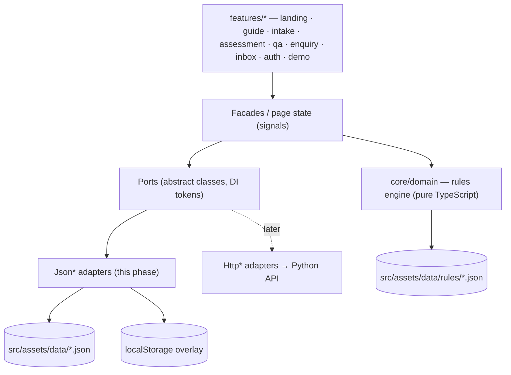

# Invest Moz

**The guide to investing in Mozambique, with an assistant that applies it to your project.**
A partnership between **Tax Advisory**, which supplies and reviews the legal and tax content, and
**Law Technology Solutions (LTS)**, which builds the technology.

This repository is the **proof of concept (POC)** used to present the full user flow and UX to the client.
- There is **no backend**. Everything runs in the browser on JSON seed data.
- The **investor guide** (`/:lang/guide`) is 12 prerendered chapters built from the APIEX Investment Guide 2026,
  Tax Advisory's tax sheets and registration guide, and the Lex Africa Business Guide 2025.
- The "assistant" answers come from a reviewed answer bank with simulated streaming.
- The site deploys as a **static site on Netlify**.

> The assistant gives the first map; a professional always validates detailed advice.

---

## Contents

1. [Quick start](#quick-start)
2. [Scripts](#scripts)
3. [Demo credentials](#demo-credentials)
4. [5-minute demo script](#5-minute-demo-script)
5. [Architecture](#architecture)
6. [Editing the content (JSON)](#editing-the-content-json)
7. [Deploying to Netlify](#deploying-to-netlify)
8. [Quality checks](#quality-checks)
9. [Future backend](#future-backend)
10. [Credits](#credits)

---

## Quick start

Requirements: **Node 24** (see `.nvmrc`; Angular 22 needs Node ≥ 22.22 or ≥ 24.15) and npm.

```bash
npm ci
npm start                 # dev server → http://localhost:4200/pt
```

To check the production build exactly as Netlify serves it (prerendered pages, SPA fallback, CSP, compression):

```bash
npm run build             # dist/invest-moz/browser (+ sitemap, _headers via postbuild)
npm run preview           # → http://localhost:4310/pt
```

## Scripts

| Command | What it does |
|---|---|
| `npm start` | Dev server with live reload |
| `npm run build` | Production build with prerendering (81 static pages), then `postbuild` |
| `npm run preview` | Serves `dist/` the way Netlify does |
| `npm run lint` | angular-eslint (TypeScript + template accessibility rules) |
| `npm run typecheck` | Strict TypeScript for the app and the tests |
| `npm test` | Unit tests (Vitest via the Angular builder) |
| `npm run test:coverage` | Unit tests with coverage; fails below 90% on `core/domain` |
| `npm run check` | Data schemas + i18n completeness + pre-AO90 orthography |
| `npm run e2e` | Playwright smoke flow (PT at 360px, EN at 1440px). First run: `npx playwright install chromium` |
| `npm run ci` | Lint, types, coverage, checks and build (what CI runs) |
| `npm run data:schemas` | Regenerates the JSON Schemas from `scripts/build-schemas.mjs` |
| `npm run data:confirm` | Regenerates `CONTENT_TO_CONFIRM.md` |
| `npm run format` | Prettier |

## Demo credentials

| | |
|---|---|
| Email | `demo@taxadvisorymoz.com` |
| Password | `InvestMoz2026` |

The credentials are shown on the landing page ("Acesso de demonstração") and prefilled on `/pt/login`.

> **This is not real security.** The POC has no server: the "login" compares public values in the browser
> (`src/app/core/config/demo-credentials.ts`) and stores a flag in `localStorage`. Real authentication arrives
> with the backend.

**Presenter shortcuts**
- **Shift + D** opens the demo panel on any screen. You can load an example, jump to a screen, switch
  language, toggle dark mode or **reset the demo data**.
- The same controls are at `/pt/demo`, and `/pt/demo/ui` is the living style guide.

## 5-minute demo script

Reset the data first: **Shift + D → "Repor dados de demonstração"**.

1. **Landing (PT), 45 s.** Open `/pt`.
   - The hero leads with **Ler o guia do investidor**; below it, the twelve guide chapters.
   - Point to the eight legal regimes, each with its main instrument.
   - Read the "how it works" line: free general information; paid detailed advice.
   - Hover a province on the map. Mention the trust principles: reviewed base, *a confirmar* instead of
     invented numbers, pre-AO90 Portuguese.
   - *(Optional, 30 s)* Open **Guia → Impostos**: the tax indicators and the treaty table, each with its
     source, then **Próximos passos** at the end of the chapter.
2. **Project, 45 s.** Click **Descrever o meu projecto → Carregar exemplo →** *Indústria agro-alimentar ·
   processamento de amêndoas* (cashew, Nampula).
   - Show the fields: Indian investor, mixed capital, USD 2.5M, 80 workers (4 foreign), the six facts.
   - Click **Preparar o enquadramento** and let the checks tick.
3. **Assessment, 90 s.**
   - Lda recommended, with the reasoning and the alternatives.
   - The **company vs. branch** table.
   - The APIEX path and the MZN 6.5M FDI guarantee.
   - The **six-step roadmap**: environmental licence on the red critical path, 4–6 months to operate,
     DUAT up to 24 months.
   - The fact triggers: treaty (India 7.5% on dividends), shareholder loan 5M/10M and 2:1, fees abroad 20%
     and VAT reverse charge, foreign-worker quota (8% for 31–100 workers; 4 of 80 is within it).
   - The obligations calendar: point to the **"Antecipado"** flag (20 Dec 2026 is a Sunday → 18 Dec).
   - **Imprimir / Exportar PDF** shows the A4 memo.
4. **Switch language, 20 s.** Click **EN** (or **FR**) in the header. The same page, now in English, keeps the
   reference and the dates in local formats.
5. **Question with a citation, 45 s.** Click **Ask a question about this project → Exchange control →**
   *Can a company with a South African shareholder repatriate dividends?*
   - The answer streams: FDI registration, MZN 6.5M minimum, approved profits, 20% → 8%/15% under the treaty.
   - Click the **Lei n.º 11/2009** tag to open the citation sheet (*Illustrative*, last reviewed, excerpt).
6. **Enquiry, 40 s.** Click **Talk to Tax Advisory**.
   - The areas are preselected and the project summary is attached; open the preview.
   - Fill name, company and email, then send. You get reference **TA-IM-2026-0142**.
   - Mention the copy/mailto fallback.
7. **Firm inbox, 35 s.** Go to the landing page → **Demo access → Sign in as Tax Advisory**.
   - The new enquiry is on top with the **New** highlight.
   - Open it: attached project, link back to the full assessment.
   - Change the status to *In review* and add an internal note. Both persist after a reload.

## Architecture



- **Angular 22**: standalone components, signals, zoneless change detection, the new control flow, `OnPush`
  everywhere, strict TypeScript.
- **Rendering**: static output.
  - `/:lang`, `/:lang/guide`, `/:lang/guide/:chapter`, `/:lang/questions` and `/:lang/questions/:topic`
    are **prerendered in PT, EN and FR** (81 pages), with incremental hydration below the fold.
  - Every other route renders on the client from `index.csr.html`.
- **i18n**: Transloco with lazy scopes per feature (`src/assets/i18n/<scope>/<lang>.json`), loaded in route
  resolvers so prerendering waits for them.
  - UI strings live in the i18n files.
  - Content (legal summaries, answers, roadmap steps) is `LocalizedText` in the data files.
- **Ports** (`src/app/core/ports`):
  - `ProjectRepository`, `AssessmentService`, `KnowledgeBase`, `ReferenceData`, `QaService`,
    `EnquiryRepository`, `AuthService`, `DemoStateService`.
  - They are wired in `app.config.ts` through `provideJsonAdapters()`.
- **Rules engine** (`src/app/core/domain`): framework-free and unit-tested. It reads declarative,
  language-neutral rule tables.
- **Persistence**:
  - `localStorage` holds enquiries submitted in the demo, status changes, notes, visitor projects, the session,
    the language and the theme, layered on top of the seed.
  - Every storage call is wrapped in try/catch, with an in-memory fallback.
- **Design**:
  - Tailwind CSS v4 with tokens in `src/styles.css` (light and dark).
  - Source Serif 4, Lato and IBM Plex Mono, self-hosted via Fontsource.
  - Angular CDK for overlays, menus and dialogs.
  - Lucide icons (stroke 1.5).

```
src/app/
├─ core/
│  ├─ domain/      types, rules engine, calendar, Q&A matcher, templating (no Angular)
│  ├─ ports/       abstract services
│  ├─ adapters/    Json* adapters + safe localStorage
│  ├─ i18n/        Transloco setup, locale service, resolvers, Intl formatters
│  ├─ layout/      shell, header, footer, flag stripe, brand marks, language switcher, SEO, theme
│  └─ config/      firm details, demo credentials
├─ shared/ui/      ref-tag, ruled-table, memo-section, roadmap-timeline, obligation-calendar, …
└─ features/       landing, guide, intake, assessment, qa, enquiry, inbox, auth, demo
```

## Editing the content (JSON)

All legal and tax content lives in `src/assets/data/`. After any edit, run **`npm run check`**.

| File | Content |
|---|---|
| `guide/index.json` · `guide/chapters/*.json` | The investor guide: 12 chapters in three parts, their sources, and one file per chapter (sections with body text, key figures, steps and tables). Each chapter loads as its own lazy chunk |
| `knowledge-base.json` | 31 legal references: `instrument`, `title`, `summary`, `excerpt` (PT/EN/FR), `lastReviewed`, `status` |
| `qa/topics.json` · `qa/answers.json` | 12 topics; 48 answers (question, keywords, body, refs, "when to talk to us") |
| `projects.json` | The 5 example projects (`TA-IM-EX01`…`EX05`) |
| `enquiries.json` | The 8 seeded inbox enquiries |
| `holidays.json` | Mozambican public holidays 2026–2027 (used to shift deadlines) |
| `countries.json` | Investor countries; `treaty: true` entries are marked `illustrative` |
| `rules/*.json` | Rule tables: sectors, vehicles, APIEX, treaties, quotas, roadmap, licences, triggers, incentives, obligations, zones |
| `placeholders.json` | Every "to confirm" value, with a description (feeds `CONTENT_TO_CONFIRM.md`) |
| `schema/*.schema.json` | JSON Schemas (generated by `npm run data:schemas`) |

**Text conventions**
- Every text is `{ "pt": "…", "en": "…", "fr": "…" }`.
- **Portuguese uses pre-AO90 spelling** (projecto, actividade, sector, director…). `npm run check` fails on
  AO90 forms.
- Answer bodies use a small Markdown subset:
  - blank-line paragraphs, `- ` bullets and `**bold**`
  - inline references such as `[ref:lei-11-2009]`, which become clickable tags
  - `{{#ctx}}…{{/ctx}}` blocks, shown only when a project is in context, using `{{ctx.investorCountry}}`,
    `{{ctx.treatyRate}}` and similar variables
- **Unknown values are never invented.** Write a placeholder such as `{{APIEX_APPROVAL_THRESHOLDS}}`.
  - The app shows it as **«a confirmar»**.
  - Add it to `placeholders.json`, then run `npm run data:confirm` to refresh `CONTENT_TO_CONFIRM.md`.
  - When Tax Advisory confirms a value, replace the placeholder in all three languages and delete its
    `placeholders.json` entry.

**Rule tables**
- Each rule is `{ "id", "when": [conditions], "then": {…} }`.
- All conditions must hold. An empty `when` always matches.
- Operators: `eq`, `in` (array), `gte`, `lt`, `between` ([min, max], inclusive).
- Conditions can use every `ProjectInput` field plus derived facts:
  `sector`, `envCategory`, `envRelevant`, `foreignOwned`, `treaty`, `investmentMzn`, `fdiMinimumMet`,
  `foreignRatio`, `hasForeignWorkers`, `quotaStatus`, `relatedParties`, `corridor`, `vehicle`.
- `vehicles.json` uses the first matching rule, so its last rule must be a catch-all. Other tables include
  every matching rule.
- Texts may use `{{fact.country}}`, `{{fact.treatyRate}}`, `{{fact.ratio}}`, `{{fact.province}}` and others.

## Deploying to Netlify

The repository includes `netlify.toml`, `.nvmrc` and the `postbuild` step.

1. Push this repository to GitHub (or GitLab or Bitbucket).
2. In Netlify: **Add new site → Import an existing project**, then choose the repository.
3. Build settings. They are read from `netlify.toml`; check they match:
   - **Base directory:** *(empty)*
   - **Build command:** `npm run build`
   - **Publish directory:** `dist/invest-moz/browser`
   - **Node version:** 24 (set by `NODE_VERSION` in `netlify.toml` and by `.nvmrc`)
4. Click **Deploy**. When it finishes, the deploy URL (e.g. `https://<name>.netlify.app`) appears:
   - at the top of the site's **Site overview**
   - under **Deploys → (latest deploy) → Open production deploy**
5. *(Optional)* Set a custom domain under **Domain management**. No change is needed in the code:
   `postbuild` reads Netlify's `URL` variable for the canonical links, hreflang and `sitemap.xml`.

What Netlify serves:
- `/` redirects to `/pt` (302).
- Prerendered pages and assets are served first. Every other path falls back to `index.csr.html` (200), the
  client shell.
- Security headers come from `netlify.toml`: HSTS, Referrer-Policy, X-Content-Type-Options, X-Frame-Options,
  Permissions-Policy.
- The **Content-Security-Policy** is generated per build into `_headers`. It allows only same-origin scripts
  plus the hashes of the inline scripts that Angular hydration emits.
- Hashed JS, CSS and fonts are cached for a year (`immutable`).
- The inbox, login and demo routes send `X-Robots-Tag: noindex` and are disallowed in `robots.txt`.

CI: `.github/workflows/ci.yml` runs lint, type-check, unit tests with coverage, the data, i18n and orthography
checks, the build, and the Playwright flow. It works once the repository is on GitHub.

## Quality checks

| Check | Status |
|---|---|
| Unit tests | 62 passing. `core/domain` coverage: 99% statements, 94% branches, 100% functions and lines |
| E2E (Playwright) | The demo flow and the guide flow (landing → index → chapter → next chapter) pass in PT at 360px and in EN at 1440px, with no console errors and no horizontal scroll under the production CSP |
| Data / i18n / orthography | 31 data files valid against their schemas; 465 UI keys × 3 locales; 1,268 localised content values; pre-AO90 check passes |
| Lighthouse (mobile, local) | Accessibility 99–100, Best Practices 100, SEO 100. Performance: landing 84–90, Q&A 88–90, assessment ≈ 76 (client-rendered). Local simulated runs vary by ±5; Netlify's CDN with HTTP/2 and brotli is usually faster |

Accessibility: semantic HTML, a skip link, visible focus, keyboard-operable menus, sheets and the combobox,
44px touch targets, `prefers-reduced-motion` support and AA-contrast tokens in both themes.

## Future backend

*Not built in this phase; the architecture keeps the path open.*

1. **Typed API.** The TypeScript types in `core/domain/types.ts` become Pydantic models in a FastAPI service.
   Its OpenAPI schema generates the TypeScript client.
2. **Same rules in Python.** The Python engine loads the same `rules/*.json` and JSON Schemas. The TypeScript
   test fixtures become pytest fixtures, to prove both engines give identical results.
3. **One-line switch.** `Http*` adapters implement the same ports. `provideJsonAdapters()` is replaced by
   `provideHttpAdapters()` in `app.config.ts`, with no component changes.
4. **Real answers.** `QaService.stream()` consumes SSE from a RAG endpoint (Postgres + pgvector hybrid search
   + the Claude API). Citations then show the real retrieved passages.
5. **Data and access.** Enquiries move to Postgres, and real authentication replaces the demo login.
6. **Hosting.** The API runs in Docker on AWS or a VPS behind an `/api` proxy. The frontend can stay on
   Netlify (add the proxy redirect and extend `connect-src` in the CSP).

Roadmap after approval:
- **Phase 1:** public version on taxadvisorymoz.com
- **Phase 2:** reach (WhatsApp, more languages, sector packs)
- **Phase 3:** institutional (chambers of commerce, APIEX or municipality versions, quarterly legal review)

## Credits

- **Map:** Natural Earth 1:10m admin-1 boundaries, public domain (naturalearthdata.com).
  Built with `scripts/build-map.mjs`.
- **Icons:** Lucide, ISC License. The used subset is generated by `scripts/build-icons.mjs`.
- **Fonts:** Source Serif 4, Lato and IBM Plex Mono (SIL Open Font License), via Fontsource.
- **Legal content:** illustrative, based on the client deck, the APIEX Investment Guide 2026, Tax Advisory's
  tax indicators, treaty table and registration guide, and the Lex Africa / JLA Business Guide 2025. See
  `CONTENT_TO_CONFIRM.md` for every value Tax Advisory must confirm.
