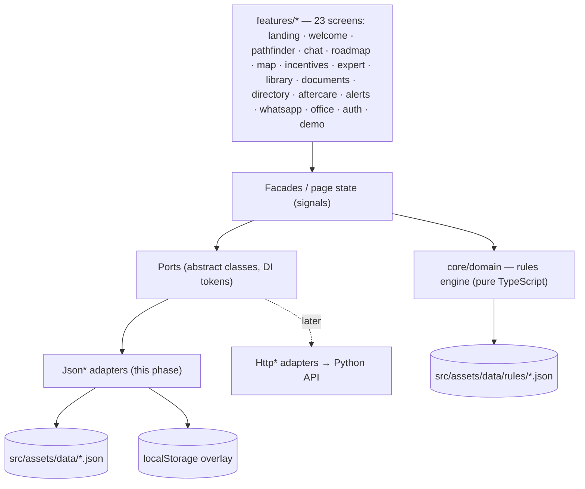

# Tiva

**“To know”, in Changana — the AI investment concierge for Mozambique.**
Tell Tiva your idea and get your Mozambique investment roadmap in minutes: company, licences, incentives,
visas and tax steps, each cited to Mozambican law, in eight languages. Built by **Law Technology Solutions
(LTS)** with **Tax Advisory** as expert partner, which supplies and validates the legal and tax content.

This repository is the **proof of concept (POC)** of the 23-screen Tiva screen pack (October 2026).
- There is **no backend**. Everything runs in the browser on JSON seed data and a `localStorage` overlay.
- The "AI" answers come from a lawyer-reviewed answer bank with simulated streaming; the back office shows
  how drafts, reviews and leads would flow.
- Eight languages: **PT, EN, FR** (reviewed) and **中文, العربية (RTL), हिन्दी, Kiswahili, Afrikaans**
  (machine translations, shown with a "translation under review" notice).
- The site deploys as a **static site on Netlify**.

> The assistant gives the first map; a professional always validates detailed advice.

---

## Contents

1. [Quick start](#quick-start)
2. [Scripts](#scripts)
3. [Demo credentials](#demo-credentials)
4. [5-minute demo script](#5-minute-demo-script)
5. [Architecture](#architecture)
6. [Editing the content (JSON)](#editing-the-content-json)
7. [Deploying to Netlify](#deploying-to-netlify)
8. [Quality checks](#quality-checks)
9. [Future backend](#future-backend)
10. [Credits](#credits)

---

## Quick start

Requirements: **Node 24** (see `.nvmrc`; Angular 22 needs Node ≥ 22.22 or ≥ 24.15) and npm.

```bash
npm ci
npm start                 # dev server → http://localhost:4200/pt
```

To check the production build exactly as Netlify serves it (prerendered pages, SPA fallback, CSP, compression):

```bash
npm run build             # dist/invest-moz/browser (+ sitemap, _headers via postbuild)
npm run preview           # → http://localhost:4310/pt
```

## Scripts

| Command | What it does |
|---|---|
| `npm start` | Dev server with live reload |
| `npm run build` | Production build with prerendering (81 static pages), then `postbuild` |
| `npm run preview` | Serves `dist/` the way Netlify does |
| `npm run lint` | angular-eslint (TypeScript + template accessibility rules) |
| `npm run typecheck` | Strict TypeScript for the app and the tests |
| `npm test` | Unit tests (Vitest via the Angular builder) |
| `npm run test:coverage` | Unit tests with coverage; fails below 90% on `core/domain` |
| `npm run check` | Data schemas + i18n completeness + pre-AO90 orthography |
| `npm run e2e` | Playwright smoke flow (PT at 360px, EN at 1440px). First run: `npx playwright install chromium` |
| `npm run ci` | Lint, types, coverage, checks and build (what CI runs) |
| `npm run data:schemas` | Regenerates the JSON Schemas from `scripts/build-schemas.mjs` |
| `npm run data:confirm` | Regenerates `CONTENT_TO_CONFIRM.md` |
| `npm run format` | Prettier |

## Demo credentials

| | |
|---|---|
| Email | `demo@taxadvisorymoz.com` |
| Password | `InvestMoz2026` |

They are prefilled on `/pt/login` (the back office, `/pt/office`).

> **This is not real security.** The POC has no server: the "login" compares public values in the browser
> (`src/app/core/config/demo-credentials.ts`) and stores a flag in `localStorage`. Real authentication arrives
> with the backend.

**Presenter shortcuts**
- **Shift + D** opens the demo panel on any screen: load an example, jump to any of the 23 screens, switch
  language, toggle dark mode or **reset the demo data**.
- The same controls are at `/pt/demo`, and `/pt/demo/ui` is the living style guide.

## The 23 screens

| # | Screen | Route (`/:lang/…`) |
|---|---|---|
| 1 | Landing page (idea box → chat) | `` |
| 2 | Roadmap PDF export (A4, print) | `roadmap/:ref/pdf` |
| 3 | Welcome and language | `welcome` |
| 4 | Investment Pathfinder (six questions) | `pathfinder` |
| 5 | Chat with Tiva (cited answers, voice) | `chat?q=` |
| 6 | Investment roadmap (nine steps, progress) | `roadmap/:ref` |
| 7 | Opportunity map (corridors, zones, sectors) | `map` |
| 8 | Incentive estimator (general / SEZ / IFZ) | `incentives` |
| 9 | Talk to an expert (consent, referral fees) | `expert` |
| 10 | Call requested | `expert/sent/:ref` |
| 11 | Knowledge library (search, new-law banner) | `library` |
| 12 | Library article (EN/PT, source, review date) | `library/:chapter` |
| 13 | Documents and forms (checklist per step) | `documents?step=` |
| 14 | Ecosystem directory | `directory` |
| 15 | Aftercare calendar (INSS, IRPS, IVA, DIRE) | `aftercare` |
| 16 | Regulatory watch (linked to roadmap steps) | `alerts` |
| 17 | WhatsApp channel (voice notes) | `whatsapp` |
| 18 | Validation queue | `office/queue` |
| 19 | Legal knowledge base | `office/knowledge-base` |
| 20 | Conversation review | `office/conversations` |
| 21 | Leads (pipeline, fit score) | `office/leads` |
| 22 | Investor intelligence | `office/intelligence` |
| 23 | Partners and directory | `office/partners` |

Earlier Invest Moz addresses (`/guide`, `/project`, `/assessment/:ref`, `/questions`, `/contact`, `/inbox`)
redirect to their Tiva equivalents.

## 5-minute demo script

Reset the data first: **Shift + D → "Repor dados de demonstração"**.

1. **Landing (PT), 40 s.** Open `/pt`. Type an idea in the idea box (or tap an example) → **Perguntar**.
2. **Chat, 40 s.** Tiva answers with legal-source chips; tap a chip to open the citation. Point to the
   roadmap card and the quick replies.
3. **Pathfinder → roadmap, 60 s.** `/pt/pathfinder` → **Carregar um exemplo** (cashew, Nampula) → finish.
   The nine steps, the current one open with documents and legal basis; tick one off; **Descarregar PDF**.
4. **Map and incentives, 40 s.** `/pt/map` → Nampula / Nacala corridor → **Ver incentivos**: the CBF warning.
5. **Expert, 40 s.** **Falar com um especialista**: Tax Advisory beside free public bodies, the shared summary,
   consent, referral fees → the call is requested.
6. **Tools, 40 s.** Library article (EN/PT toggle), documents checklist, aftercare calendar (deadlines moved off
   weekends), regulatory watch, WhatsApp voice note.
7. **Languages, 20 s.** Switch to العربية (right to left) and 中文.
8. **Back office, 40 s.** `/pt/login` → validation queue (approve a draft), knowledge base, leads (the new
   request is on top), investor intelligence.

## Architecture



- **Angular 22**: standalone components, signals, zoneless change detection, the new control flow, `OnPush`
  everywhere, strict TypeScript.
- **Rendering**: static output.
  - `/:lang`, `/:lang/library` and `/:lang/library/:chapter` are **prerendered in all eight locales**
    (112 pages), with incremental hydration below the fold.
  - `data.chrome` on a route picks the page chrome: `site` (header and footer), `app` (full-screen mobile
    screens: welcome, chat, WhatsApp, PDF) or `office` (back-office sidebar). See `core/layout/route-chrome.ts`.
  - Every other route renders on the client from `index.csr.html`.
- **i18n**: eight locales (`LOCALES` in `core/domain/types.ts`); Arabic sets `<html dir="rtl">` and the CSS
  uses logical properties. Transloco with lazy scopes per feature (`src/assets/i18n/<scope>/<lang>.json`),
  indexed by `scripts/build-i18n-index.mjs`, loaded in route resolvers so prerendering waits for them.
  Missing keys fall back to English; `pickText()` does the same for `LocalizedText`.
  - UI strings live in the i18n files.
  - Content (legal summaries, answers, roadmap steps) is `LocalizedText` in the data files.
- **Ports** (`src/app/core/ports`):
  - `ProjectRepository`, `AssessmentService`, `KnowledgeBase`, `ReferenceData`, `QaService`,
    `EnquiryRepository`, `AuthService`, `DemoStateService`.
  - They are wired in `app.config.ts` through `provideJsonAdapters()`.
- **Rules engine** (`src/app/core/domain`): framework-free and unit-tested. It reads declarative,
  language-neutral rule tables.
- **Persistence**:
  - `localStorage` holds enquiries submitted in the demo, status changes, notes, visitor projects, the session,
    the language and the theme, layered on top of the seed.
  - Every storage call is wrapped in try/catch, with an in-memory fallback.
- **Design**:
  - Tailwind CSS v4 with tokens in `src/styles.css` (light and dark).
  - The Tiva screen-pack palette (deep green, cream, flag yellow) and Fraunces, Manrope and IBM Plex Mono,
    self-hosted via Fontsource; Chinese, Arabic and Devanagari use the system's script fonts.
  - Partner logos in `public/brand/`.
  - Angular CDK for overlays, menus and dialogs.
  - Lucide icons (stroke 1.5).

```
src/app/
├─ core/
│  ├─ domain/      types, rules engine, calendar, Q&A matcher, templating (no Angular)
│  ├─ ports/       abstract services
│  ├─ adapters/    Json* adapters + safe localStorage
│  ├─ i18n/        Transloco setup, locale service, resolvers, Intl formatters
│  ├─ layout/      shell, header, footer, flag stripe, brand marks, language switcher, SEO, theme
│  └─ config/      firm details, demo credentials
├─ shared/ui/      ref-tag, answer-block, citation sheet, ruled-table, obligation-calendar, …
└─ features/       landing, welcome, pathfinder, chat, roadmap, map, incentives, expert, library,
                   documents, directory, aftercare, alerts, whatsapp, office, auth, demo
                   (guide, qa and enquiry keep only resolvers/helpers still in use)
```

## Editing the content (JSON)

All legal and tax content lives in `src/assets/data/`. After any edit, run **`npm run check`**.

| File | Content |
|---|---|
| `guide/index.json` · `guide/chapters/*.json` | The knowledge library (from the investor guide): 12 chapters in three parts, their sources, and one file per chapter (sections with body text, key figures, steps and tables). Each chapter loads as its own lazy chunk |
| `knowledge-base.json` | 31 legal references: `instrument`, `title`, `summary`, `excerpt` (PT/EN/FR), `lastReviewed`, `status` |
| `qa/topics.json` · `qa/answers.json` | 12 topics; 48 answers (question, keywords, body, refs, "when to talk to us") |
| `projects.json` | The 5 example projects (`TA-IM-EX01`…`EX05`) |
| `enquiries.json` | The 8 seeded enquiries (back-office leads) |
| `roadmap/steps.json` | The nine roadmap steps (who, documents, legal basis); ids in `core/domain/roadmap-steps.ts` |
| `map/` · `incentives/` · `expert/` | Opportunity map profiles, estimator settings, the experts and public bodies for the handoff |
| `documents/` · `directory/` · `alerts/` | Checklists per roadmap step, directory listings, regulatory-watch alerts |
| `office/` | Back-office seed: validation queue, diplomas, conversations, intelligence, partners (illustrative) |
| `holidays.json` | Mozambican public holidays 2026–2027 (used to shift deadlines) |
| `countries.json` | Investor countries; `treaty: true` entries are marked `illustrative` |
| `rules/*.json` | Rule tables: sectors, vehicles, APIEX, treaties, quotas, roadmap, licences, triggers, incentives, obligations, zones |
| `placeholders.json` | Every "to confirm" value, with a description (feeds `CONTENT_TO_CONFIRM.md`) |
| `schema/*.schema.json` | JSON Schemas (generated by `npm run data:schemas`) |

**Text conventions**
- Every text is `{ "pt": "…", "en": "…", "fr": "…", "zh": "…", "ar": "…", "hi": "…", "sw": "…", "af": "…" }`.
  PT, EN and FR are reviewed; the other five are machine translations. To add or refresh a locale:
  `node scripts/i18n-todo.mjs export <file|i18n-folder> <lang> todo.json`, translate the values, then
  `node scripts/i18n-todo.mjs apply <same target> <lang> translations.json` (keeps placeholders, refs and
  key order; safe with several writers). Legal citations stay in Portuguese in every language.
- **Portuguese uses pre-AO90 spelling** (projecto, actividade, sector, director…). `npm run check` fails on
  AO90 forms.
- Answer bodies use a small Markdown subset:
  - blank-line paragraphs, `- ` bullets and `**bold**`
  - inline references such as `[ref:lei-11-2009]`, which become clickable tags
  - `{{#ctx}}…{{/ctx}}` blocks, shown only when a project is in context, using `{{ctx.investorCountry}}`,
    `{{ctx.treatyRate}}` and similar variables
- **Unknown values are never invented.** Write a placeholder such as `{{APIEX_APPROVAL_THRESHOLDS}}`.
  - The app shows it as **«a confirmar»**.
  - Add it to `placeholders.json`, then run `npm run data:confirm` to refresh `CONTENT_TO_CONFIRM.md`.
  - When Tax Advisory confirms a value, replace the placeholder in all three languages and delete its
    `placeholders.json` entry.

**Rule tables**
- Each rule is `{ "id", "when": [conditions], "then": {…} }`.
- All conditions must hold. An empty `when` always matches.
- Operators: `eq`, `in` (array), `gte`, `lt`, `between` ([min, max], inclusive).
- Conditions can use every `ProjectInput` field plus derived facts:
  `sector`, `envCategory`, `envRelevant`, `foreignOwned`, `treaty`, `investmentMzn`, `fdiMinimumMet`,
  `foreignRatio`, `hasForeignWorkers`, `quotaStatus`, `relatedParties`, `corridor`, `vehicle`.
- `vehicles.json` uses the first matching rule, so its last rule must be a catch-all. Other tables include
  every matching rule.
- Texts may use `{{fact.country}}`, `{{fact.treatyRate}}`, `{{fact.ratio}}`, `{{fact.province}}` and others.

## Deploying to Netlify

The repository includes `netlify.toml`, `.nvmrc` and the `postbuild` step.

1. Push this repository to GitHub (or GitLab or Bitbucket).
2. In Netlify: **Add new site → Import an existing project**, then choose the repository.
3. Build settings. They are read from `netlify.toml`; check they match:
   - **Base directory:** *(empty)*
   - **Build command:** `npm run build`
   - **Publish directory:** `dist/invest-moz/browser`
   - **Node version:** 24 (set by `NODE_VERSION` in `netlify.toml` and by `.nvmrc`)
4. Click **Deploy**. When it finishes, the deploy URL (e.g. `https://<name>.netlify.app`) appears:
   - at the top of the site's **Site overview**
   - under **Deploys → (latest deploy) → Open production deploy**
5. *(Optional)* Set a custom domain under **Domain management**. No change is needed in the code:
   `postbuild` reads Netlify's `URL` variable for the canonical links, hreflang and `sitemap.xml`.

What Netlify serves:
- `/` redirects to `/pt` (302).
- Prerendered pages and assets are served first. Every other path falls back to `index.csr.html` (200), the
  client shell.
- Security headers come from `netlify.toml`: HSTS, Referrer-Policy, X-Content-Type-Options, X-Frame-Options,
  Permissions-Policy.
- The **Content-Security-Policy** is generated per build into `_headers`. It allows only same-origin scripts
  plus the hashes of the inline scripts that Angular hydration emits.
- Hashed JS, CSS and fonts are cached for a year (`immutable`).
- The back-office, login and demo routes send `X-Robots-Tag: noindex` and are disallowed in `robots.txt`.

CI: `.github/workflows/ci.yml` runs lint, type-check, unit tests with coverage, the data, i18n and orthography
checks, the build, and the Playwright flow. It works once the repository is on GitHub.

## Quality checks

| Check | Status |
|---|---|
| Unit tests | 71 passing (rules engine, text utilities, Pathfinder idea composition, roadmap step building) |
| E2E (Playwright) | Idea → chat → roadmap (nine steps) → expert handoff → lead in the back office; library; Arabic RTL and Chinese; and a walk through all 23 screens. Pass in PT at 360px and EN at 1440px with no console errors and no horizontal scroll under the production CSP |
| Data / i18n / orthography | 31 schema-validated data files; 1,192 UI keys × 8 locales; 1,593 localised content values; pre-AO90 check passes |
| Lighthouse | Not re-measured after the Tiva redesign. The eight-locale content makes the answer bank (≈ 670 kB raw, 127 kB compressed) the largest lazy chunk |

Accessibility: semantic HTML, a skip link, visible focus, keyboard-operable menus, sheets and the combobox,
44px touch targets, `prefers-reduced-motion` support and AA-contrast tokens in both themes.

## Future backend

*Not built in this phase; the architecture keeps the path open.*

1. **Typed API.** The TypeScript types in `core/domain/types.ts` become Pydantic models in a FastAPI service.
   Its OpenAPI schema generates the TypeScript client.
2. **Same rules in Python.** The Python engine loads the same `rules/*.json` and JSON Schemas. The TypeScript
   test fixtures become pytest fixtures, to prove both engines give identical results.
3. **One-line switch.** `Http*` adapters implement the same ports. `provideJsonAdapters()` is replaced by
   `provideHttpAdapters()` in `app.config.ts`, with no component changes.
4. **Real answers.** `QaService.stream()` consumes SSE from a RAG endpoint (Postgres + pgvector hybrid search
   + the Claude API). Citations then show the real retrieved passages.
5. **Data and access.** Enquiries move to Postgres, and real authentication replaces the demo login.
6. **Hosting.** The API runs in Docker on AWS or a VPS behind an `/api` proxy. The frontend can stay on
   Netlify (add the proxy redirect and extend `connect-src` in the CSP).

Roadmap after approval (see the screen pack, "From screens to MVP"):
- **Phase 1:** public version on taxadvisorymoz.com
- **Phase 2:** reach (WhatsApp, more languages, sector packs)
- **Phase 3:** institutional (chambers of commerce, APIEX or municipality versions, quarterly legal review)

## Credits

- **Map:** Natural Earth 1:10m admin-1 boundaries, public domain (naturalearthdata.com).
  Built with `scripts/build-map.mjs`.
- **Icons:** Lucide, ISC License. The used subset is generated by `scripts/build-icons.mjs`.
- **Fonts:** Source Serif 4, Lato and IBM Plex Mono (SIL Open Font License), via Fontsource.
- **Legal content:** illustrative, based on the client deck, the APIEX Investment Guide 2026, Tax Advisory's
  tax indicators, treaty table and registration guide, and the Lex Africa / JLA Business Guide 2025. See
  `CONTENT_TO_CONFIRM.md` for every value Tax Advisory must confirm.
